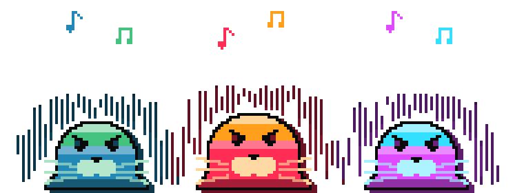
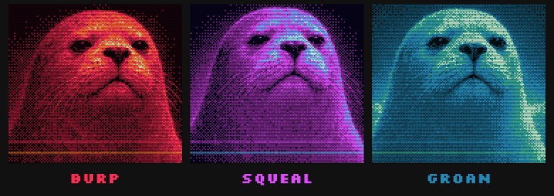
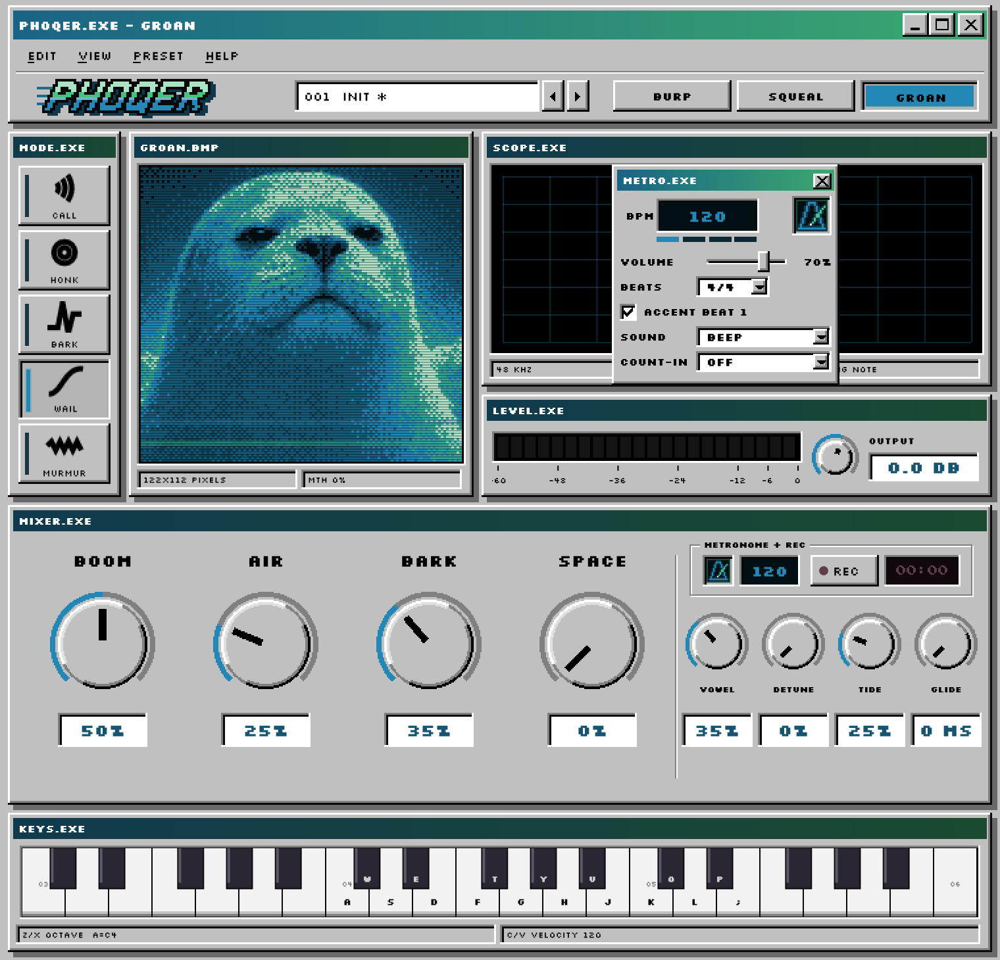

<p align="center">
  
</p>

<p align="center"><em>A seal you can play. A synthetic vocal instrument for Windows.</em></p>

<p align="center">
  <a href="https://github.com/lew0nn/phoqer/releases/tag/v1.0.0"></a>
  <a href="#download"></a>
  <a href="#download"></a>
  <a href="https://github.com/juce-framework/JUCE/releases/tag/8.0.8"></a>
  <a href="CMakeLists.txt"></a>
  <a href="LICENSE"></a>
  <a href="https://github.com/lew0nn/phoqer/releases/latest"></a>
</p>

<br>
<br>

<p align="center">
  
</p>

<br>
<br>

PHOQER builds every call while you play it. Formant-wave-function synthesis, the technique behind
Chant and Delay Lama, makes each resonance of the seal's throat from overlapping grains, shaped by
formant tables and pitch contours measured from real seal calls. The recordings were the reference;
none of them are in the instrument.

<br>

## Features

- **Three seals:** BURP, SQUEAL and GROAN, each with its own voice, colours and a portrait that
  reacts as it sings.
- **Five moods** for a held note: one call, honks, barks, a wail or a hum, in time with your song.
- **Nine knobs**, from BOOM to GLIDE, every one automatable.
- **Eight voices**, with velocity, pitch bend, the sustain pedal and the mod wheel.
- **No samples:** every call is synthesised while you play.
- Ships with **16 presets**.
- **Standalone app** with a computer-key piano, REC to WAV and a metronome with a count-in.
- **VST3 and standalone** for Windows x64. Free and open source.

<br>
<br>

## Download

### [Windows installer](https://github.com/lew0nn/phoqer/releases/download/v1.0.0/PHOQER-1.0.0-Windows-x64-Setup.exe)

Installs the VST3 plug-in, the standalone app, or both.

### [VST3](https://github.com/lew0nn/phoqer/releases/download/v1.0.0/PHOQER-1.0.0-Windows-x64-VST3.zip)

The complete `PHOQER.vst3` bundle for Windows x64 hosts.

### [Standalone](https://github.com/lew0nn/phoqer/releases/download/v1.0.0/PHOQER-1.0.0-Windows-x64-Standalone.zip)

Runs PHOQER without a DAW; audio and MIDI devices are set from its EDIT menu.

The installer is not code-signed, so Windows SmartScreen may stop it the first time: choose
**More info**, then **Run anyway**.

<br>
<br>

## Seals

<p align="center">
  
</p>

- **BURP:** the bass, and the default. A low, rough bark whose growl comes from jitter and period
  doubling, not breath.
- **SQUEAL:** short, bright yelps that start high, drop, then lift again.
- **GROAN:** a long, warm "ooh" that scoops up into the note and sways with a slow vibrato.

Each seal has its own colours, and its portrait reacts as it sings.

<br>

## Moods

How a held note behaves. HONK, BARK and WAIL keep time with your song.

| Mood | What the seal does |
| --- | --- |
| CALL | One call per note |
| HONK | Nasal honks on 1/8 notes for as long as you hold the key |
| BARK | Hard barks on 1/4 notes, silence between |
| WAIL | One long glide up and back over two bars |
| MURMUR | A muttered, closed-mouth hum |

<br>

## Controls

| Knob | What it does |
| --- | --- |
| BOOM | The seal's size: small, or big with more chest |
| AIR | Breath, from none at all |
| BARK | Attack and growl: a soft swell to a hard hit |
| SPACE | Reverb: dry to a big dark cave |
| VOWEL | OO, OH, AH, EH, EE |
| DETUNE | Width: one voice to a wide double |
| TIDE | Expression: a straight note to scoops and vibrato |
| GLIDE | 0 to 2 s: a note played over a held one slides in from its pitch; chords struck together don't slide |
| OUTPUT | The level. A limiter holds the ceiling, so push it |

MIDI: velocity, pitch bend (two semitones), the sustain pedal (CC 64), and the mod wheel (CC 1),
which adds TIDE on top of the knob. Every knob can be automated.

<br>

## Standalone app

The standalone app adds a few things of its own:

- **KEYS.EXE** turns the computer keyboard into a piano: A to ; play, Z / X change octave,
  C / V change velocity.
- **REC** records what you play to a WAV file.
- **A metronome** beside REC. Click the BPM to open METRO.EXE: tempo, volume, 2/4 to 7/4 with an
  accented first beat, three click sounds (BEEP, WOOD and SEAL), and a one- or two-bar count-in
  before REC starts. The click is never recorded.

In a DAW, PHOQER follows the project's tempo, and the metronome and REC are hidden.

<p align="center">
  
</p>

<br>

## Interface

Ships with 16 presets; save your own as `.phqpreset` files. The interface is a set of Win98 programs: the seal's portrait,
SCOPE.EXE with its waveform and spectrogram, LEVEL.EXE, MIXER.EXE and KEYS.EXE. The menus hold undo
and redo, copying and pasting settings, reverting to the preset, a panic button, zoom, a controls
guide and the keyboard shortcuts.

<br>

## Technical details

<details>
<summary><strong>Sound engine & level</strong></summary>

Each seal is a table of formant frequencies, bandwidths and amplitudes, plus the pitch contour of a
real call: where it starts, how it scoops and where it settles. Eight voices share one engine; a held
note sounds for as long as the key is down, and the mood keeps moving it.

One note at full velocity peaks near -10 dBFS. A stereo-linked lookahead limiter holds the output at
-0.3 dBFS; it looks 2 ms ahead, which PHOQER reports to the host as latency.

</details>

<details>
<summary><strong>Presets & state</strong></summary>

Host state uses stable parameter IDs, so sessions saved with earlier versions load, with any newer
setting at its default. Presets carry the sound only: loading one never changes OUTPUT, the tempo or
the metronome, and older presets set GLIDE back to 0. The standalone app's tempo and metronome
settings are not automatable.

</details>

<details>
<summary><strong>CPU cost</strong></summary>

PHOQER's cost follows how many notes are sounding: each held note is its own voice, built from
grains in real time. Eight held notes, the most it plays at once, take 12 to 14% of one core.

Measured on one core of an Intel Core i5-14400F, 44.1 kHz, stereo, 128-sample blocks, one instance
with its default settings, as a share of realtime (the sound engine; the window's drawing is not
included):

| Notes held | BURP | SQUEAL | GROAN |
| --- | --- | --- | --- |
| 1 | ~2% | ~2% | ~2% |
| 4 | ~7% | ~6% | ~7% |
| 8 | ~14% | ~12% | ~14% |

To measure your own machine, build from source and run `PHOQERPerformanceSanity --cpu`.

</details>

<details>
<summary><strong>Testing</strong></summary>

Steinberg's VST3 validator passes all 47 tests. PHOQER's own checks cover the engine and the three
seals, chords and GLIDE, the limiter's ceiling across sample rates and block sizes, session recall
and presets, the metronome's timing and count-in, and the built VST3 in a host across 300
combinations of seal, mood, sample rate and block size. See [README_DEV.md](README_DEV.md).

</details>

<details>
<summary><strong>Manual installation</strong></summary>

### VST3

Extract the VST3 package and copy the complete `PHOQER.vst3` bundle to:

```text
C:\Program Files\Common Files\VST3
```

Rescan plug-ins in the host.

### Standalone

Extract the standalone package and run `PHOQER.exe`. Audio and MIDI are set from EDIT ▸ AUDIO/MIDI SETUP.

</details>

<details>
<summary><strong>Build from source</strong></summary>

Requirements: Windows x64, CMake 3.22+, Visual Studio 2022 with the MSVC desktop C++ toolchain, Git,
and the pinned JUCE submodule. For the installer, [Inno Setup 6](https://jrsoftware.org/isinfo.php).

```powershell
git clone --recurse-submodules https://github.com/lew0nn/phoqer.git
Set-Location phoqer
powershell -ExecutionPolicy Bypass -File .\build-release.ps1
```

The installer and the VST3 and standalone zips are written to `dist\release`. Without Inno Setup the
script still builds the zips.

Built with C++17, JUCE 8.0.8 and CMake.

</details>

<br>

## License

<p align="center">
  <strong><a href="LICENSE">GNU Affero General Public License v3.0</a></strong>
</p>

<p align="center">PHOQER's original source code and project assets are free and open-source software.<br>
Make and release music with it however you like: no credit needed, no royalties.</p>

<p align="center">JUCE and all other third-party components retain their respective licences.<br>See <a href="THIRD_PARTY_NOTICES.md">Third-Party Notices</a>.</p>

<p align="center"><sub>Copyright © 2026 lewonn / LWNX DSP. VST is a trademark of Steinberg Media Technologies GmbH.</sub></p>

<p align="center">Bugs and sound ideas: <a href="https://github.com/lew0nn/phoqer/issues">Issues</a> · <a href="CONTRIBUTING.md">Contributing</a></p>

<p align="center"><strong>PHOQER 1.0.0 · LWNX DSP</strong></p>
