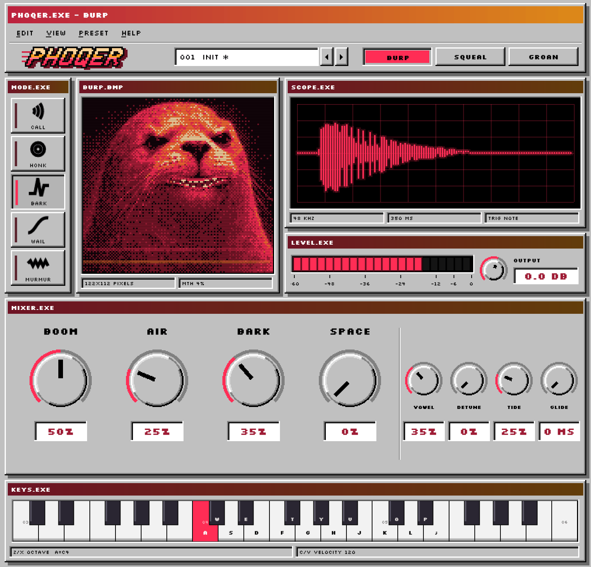
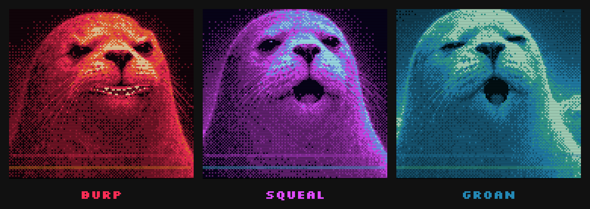

<p align="center">
  
</p>

<p align="center"><strong>A seal you can play.</strong><br>
A synthetic vocal instrument for Windows: three seals, five moods, eight voices, no samples.</p>

<p align="center">
  <a href="https://github.com/lew0nn/phoqer/releases/tag/v1.0.0"></a>
  <a href="#download"></a>
  <a href="#download"></a>
  <a href="LICENSE"></a>
  <a href="https://github.com/lew0nn/phoqer/releases/latest"></a>
</p>

<p align="center">
  
</p>

<p align="center"><a href="#download"><strong>Download PHOQER 1.0.0</strong></a> &middot; free and open source</p>

## Meet the seals

<p align="center">
  
</p>

- **BURP** is the bass: a low, rough bark whose growl comes from jitter and period doubling,
  not breath. The default, and the best seal.
- **SQUEAL** yelps: short, bright bursts that start high, drop, then lift again.
- **GROAN** moans: a long, warm "ooh" that scoops up into the note and sways with a slow vibrato.

None of them are recordings. Every call is built while you play it, by formant-wave-function
synthesis, the technique behind Chant and Delay Lama: each resonance of the seal's throat is
made of overlapping grains, shaped by formant tables and pitch contours measured from real seal
calls. The recordings were the reference; none of them are in the instrument.

## Five moods

How a held note behaves. HONK, BARK and WAIL keep time with your song.

| Mood | What the seal does |
|---|---|
| CALL | One call per note |
| HONK | Nasal honks on 1/8 notes for as long as you hold the key |
| BARK | Hard barks on 1/4 notes, silence between |
| WAIL | One long glide up and back over two bars |
| MURMUR | A muttered, closed-mouth hum |

## The knobs

| Knob | Turns the seal from... to... |
|---|---|
| BOOM | a small seal to a big one with more chest |
| AIR | no breath at all to a breathy one |
| BARK | a soft swell to a hard hit with growl |
| SPACE | dry to a big dark cave |
| VOWEL | OO, OH, AH, EH, EE |
| DETUNE | one voice to a wide double |
| TIDE | a dead-straight note to scoops and vibrato |
| GLIDE | 0 to 2 seconds: a note played over a held one slides in from its pitch (chords don't slide) |
| OUTPUT | the level; a limiter keeps it from clipping, so push it |

## In your DAW, or on its own

**As a VST3**, PHOQER follows your project's tempo and plays eight notes at once. It answers
to velocity, pitch bend (two semitones), the sustain pedal, and the mod wheel, which adds TIDE.
Every knob can be automated.

**As a standalone app** it brings a few things of its own:

- **KEYS.EXE** turns your computer keyboard into a piano: A to ; play, Z / X change octave,
  C / V change velocity.
- **REC** records what you play to a WAV file.
- **A metronome**, beside REC. Click the BPM to open METRO.EXE: tempo, volume, 2/4 to 7/4 with
  an accented first beat, three click sounds (BEEP, WOOD and SEAL), and a one- or two-bar
  count-in before REC starts. The click is never recorded.

<p align="center">
  
</p>

## Presets

Sixteen to start from, five per seal and an INIT:

`BRP FISH DEMAND` · `BRP HARBOUR BASS` · `BRP FOGHORN` · `BRP GRUMBLE` · `BRP PIER RIOT` ·
`SQL BEACH SOLO` · `SQL PUP` · `SQL KLAXON` · `SQL PUP CHOIR` · `SQL GOSSIP` ·
`GRN TAX AUDIT` · `GRN NIGHT TIDE` · `GRN SIREN SONG` · `GRN ICE CAVE` · `GRN HONK SHOW`

Save your own as `.phqpreset` files. The menus also hold undo and redo, copying and pasting
settings as text, reverting to the preset, a panic button, a controls guide and the keyboard
shortcuts. Somewhere in there is a fish.

## Download

### [Windows installer](https://github.com/lew0nn/phoqer/releases/download/v1.0.0/PHOQER-1.0.0-Windows-x64-Setup.exe)

Installs the VST3, the standalone app, or both. The VST3 goes to
`C:\Program Files\Common Files\VST3`, where every DAW looks.

### [VST3](https://github.com/lew0nn/phoqer/releases/download/v1.0.0/PHOQER-1.0.0-Windows-x64-VST3.zip)

The `PHOQER.vst3` bundle on its own.

### [Standalone](https://github.com/lew0nn/phoqer/releases/download/v1.0.0/PHOQER-1.0.0-Windows-x64-Standalone.zip)

Runs without a DAW; audio and MIDI devices are set from its menu.

The installer is not code-signed, so Windows SmartScreen may stop it the first time:
choose **More info**, then **Run anyway**.

## Under the hood

<details>
<summary><strong>Sound and level</strong></summary>

Each seal is a table of formant frequencies, bandwidths and amplitudes, plus the pitch contour
of a real call: where it starts, how it scoops and where it settles. Eight voices share one
engine; a held note sounds for as long as the key is down, and the mood keeps moving it.

One note at full velocity peaks near -10 dBFS. A stereo-linked lookahead limiter holds the
output at -0.3 dBFS; it looks 2 ms ahead, which PHOQER reports to the host as latency.

</details>

<details>
<summary><strong>Sessions and presets</strong></summary>

Parameters have stable IDs, so sessions saved with older versions load, with any newer setting
at its default. Presets only carry the sound: loading one never changes OUTPUT, the tempo or the
metronome. The standalone app's tempo and metronome settings are not automatable and are hidden
in a DAW, which has its own.

</details>

<details>
<summary><strong>Tested with</strong></summary>

Steinberg's VST3 validator (47 of 47 tests), plus PHOQER's own checks: the engine and the
synthesis, chords and GLIDE, the limiter's ceiling across sample rates and block sizes, session
recall and presets, the metronome's timing and count-in, and the built VST3 in a host across
300 combinations of seal, mood, sample rate and block size. See [README_DEV.md](README_DEV.md).

</details>

<details>
<summary><strong>Install by hand</strong></summary>

Unzip the VST3 package and copy the whole `PHOQER.vst3` folder to
`C:\Program Files\Common Files\VST3`, then rescan plug-ins in your DAW. For the standalone app,
unzip the package anywhere and run `PHOQER.exe`.

</details>

<details>
<summary><strong>Build from source</strong></summary>

Needs Windows x64, Git, CMake 3.22 or newer, and Visual Studio 2022 with the **Desktop
development with C++** workload. Built with C++17 and JUCE 8.0.8.

```powershell
git clone --recurse-submodules https://github.com/lew0nn/phoqer.git
Set-Location phoqer
powershell -ExecutionPolicy Bypass -File .\build-release.ps1
```

That builds the VST3 and the standalone app, and the installer if
[Inno Setup 6](https://jrsoftware.org/isinfo.php) is installed; everything lands in
`dist\release`. To build without the installer:

```powershell
cmake -S . -B build -G "Visual Studio 17 2022" -A x64
cmake --build build --config Release --target PHOQER_VST3 PHOQER_Standalone
```

For that plain build, keep the repository path free of parentheses: JUCE's Windows resource
step passes it through MSBuild unquoted (`build-release.ps1` works around it). Engine notes and the check programs are in [README_DEV.md](README_DEV.md).

</details>

## License

PHOQER's code, documentation and project assets are free software under the
[GNU AGPL v3](LICENSE) (`AGPL-3.0-only`), copyright 2026 lewonn / LWNX DSP.

Use it to make and release music however you like: no credit needed, no royalties. If you
share PHOQER itself or a changed version, the AGPL's source, licence and notice terms apply.

JUCE, the VST3 SDK, Roboto and the other third-party parts keep their own licences: see
[THIRD_PARTY_NOTICES.md](THIRD_PARTY_NOTICES.md). VST is a trademark of Steinberg Media
Technologies GmbH, registered in Europe and other countries.

## Feedback

Bug reports and sound ideas are welcome in [Issues](https://github.com/lew0nn/phoqer/issues).
For anything audio, say which DAW, sample rate, notes and settings. Before sending code or
assets, read [CONTRIBUTING.md](CONTRIBUTING.md).

<p align="center"><sub>PHOQER 1.0.0 · LWNX DSP</sub></p>
